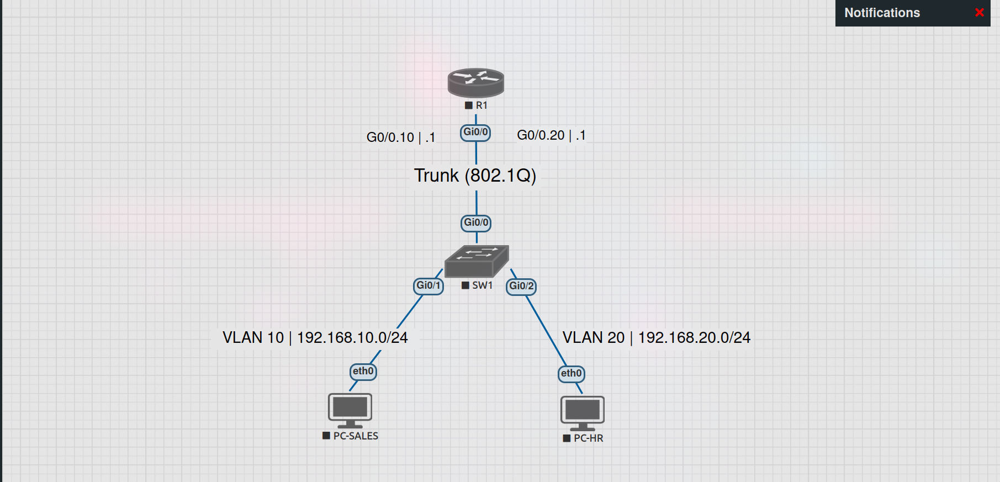
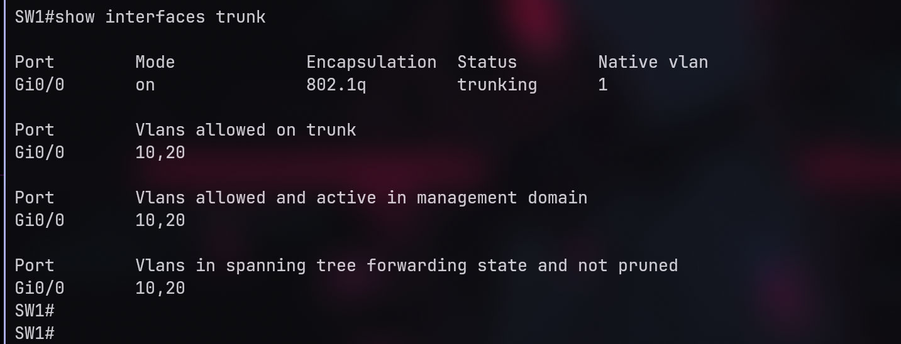
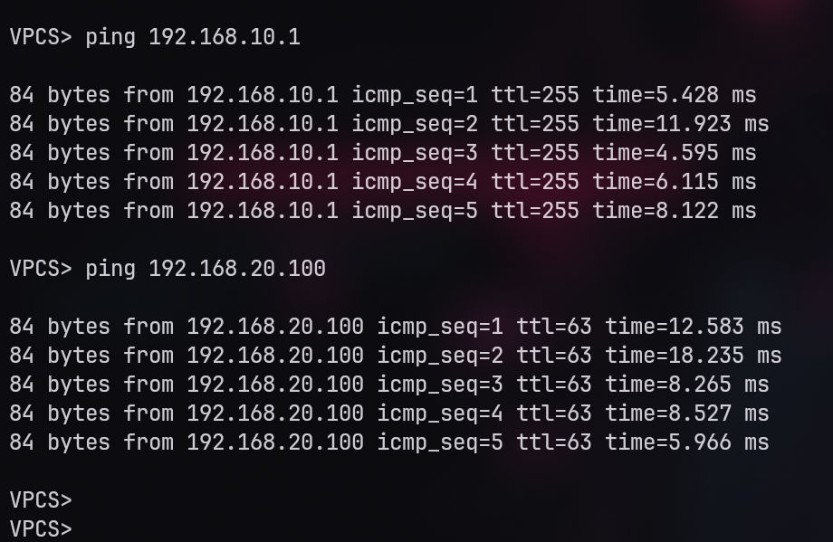

# 🏢 Project 01: Small Branch Office (VLANs, DHCP, Troubleshooting)

## 📌 Overview
A simulated small branch office network designed to separate two departments (Sales and HR) using VLANs, provide automated IP addressing via DHCP, and implement Inter-VLAN routing using a Router-on-a-Stick topology.

## 🏗️ Topology & IP Plan

- **Devices:** 1 Router (vIOS), 1 Switch (vIOS-L2), 2 PCs (VPCS).
- **VLAN 10 (SALES):** Network `192.168.10.0/24` | Gateway: `192.168.10.1`
- **VLAN 20 (HR):** Network `192.168.20.0/24` | Gateway: `192.168.20.1`

## ⚙️ Implementation
- **Layer 2:** Created VLANs 10 & 20, configured Access ports for PCs, and an 802.1Q Trunk to the router.
- **Layer 3:** Configured Sub-interfaces on R1 (Router-on-a-Stick).
- **Services:** Configured DHCP Pools on R1 to assign IPs to both departments.

## 🧪 Verification & Results
### VLAN & Trunk Status

### Connectivity Tests
PCs successfully obtained IP addresses via DHCP, and Inter-VLAN Ping was successful.

## 💥 Troubleshooting
A deliberate fault was introduced to simulate a real-world trunk misconfiguration. 
Read the full incident report here:
👉 **[View Troubleshooting Report](troubleshooting/trunk-vlan-20-issue.md)**

### Evidence of the Fix

