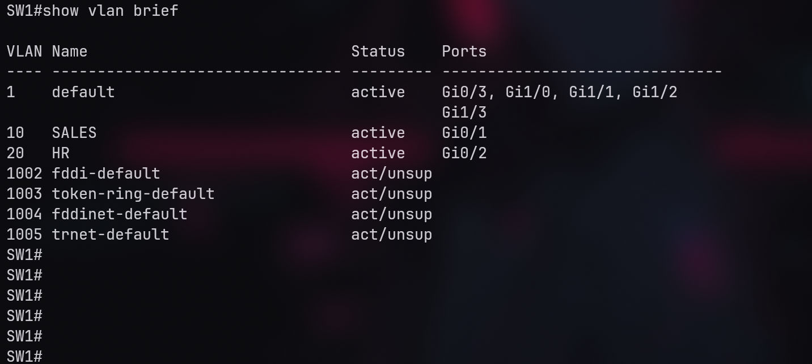

# 🏢 Project 01: Small Branch Office (VLANs, DHCP, Inter-VLAN Routing)

## 📌 Overview
A simulated small branch office network designed to separate two departments (Sales and HR) using VLANs, provide automated IP addressing via DHCP, and implement Inter-VLAN routing using a Router-on-a-Stick topology.

## 🏗️ Topology & IP Plan

- **Devices:** 1 Router (vIOS), 1 Switch (vIOS-L2), 2 PCs (VPCS).
- **VLAN 10 (SALES):** Network: 192.168.10.0/24 | Gateway: 192.168.10.1
- **VLAN 20 (HR):** Network: 192.168.20.0/24 | Gateway: 192.168.20.1

## 🛡️ Baseline Configuration
Before implementing the specific lab requirements, all devices were secured with essential baseline configurations:
- Disabled DNS lookup.
- Configured encrypted privileged EXEC passwords (`enable secret`).
- Created local user accounts (`username admin privilege 15 secret`).
- Secured VTY lines and enabled SSH (restricted Telnet).
- Added MOTD banners warning against unauthorized access.

## ⚙️ Implementation
- **Layer 2:** Created VLANs 10 & 20, configured Access ports for PCs, and an 802.1Q Trunk to the router.
- **Layer 3:** Configured Sub-interfaces on R1 (Router-on-a-Stick).
- **Services:** Configured DHCP Pools on R1 to assign IPs to both departments.

## 🧪 Verification & Results
### VLAN & Trunk Status

### Connectivity Tests
PCs successfully obtained IP addresses via DHCP, and Inter-VLAN Ping was successful.

## 💥 Troubleshooting
A deliberate fault was introduced to simulate a real-world trunk misconfiguration. VLAN 20 was missing from the allowed list on the trunk port.
Read the full incident report here:
👉 **[View Troubleshooting Report](troubleshooting/trunk-vlan-20-issue.md)**

### Evidence of the Fix

## 💡 Lessons Learned
- Always verify trunk allowed VLANs after any configuration change.
- DHCP is a reliable way to automate IP addressing in small networks.
- Placing the default gateway on the router (Router-on-a-Stick) is an efficient way to route traffic between VLANs.

## 📂 Device Configurations
- [R1 Configuration](configs/R1.md)
- [SW1 Configuration](configs/SW1.md)
