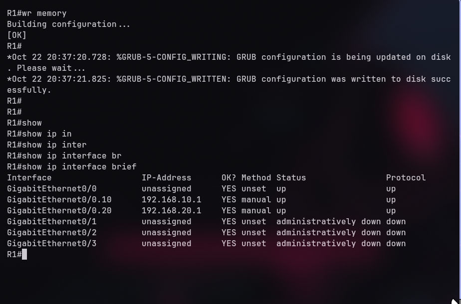
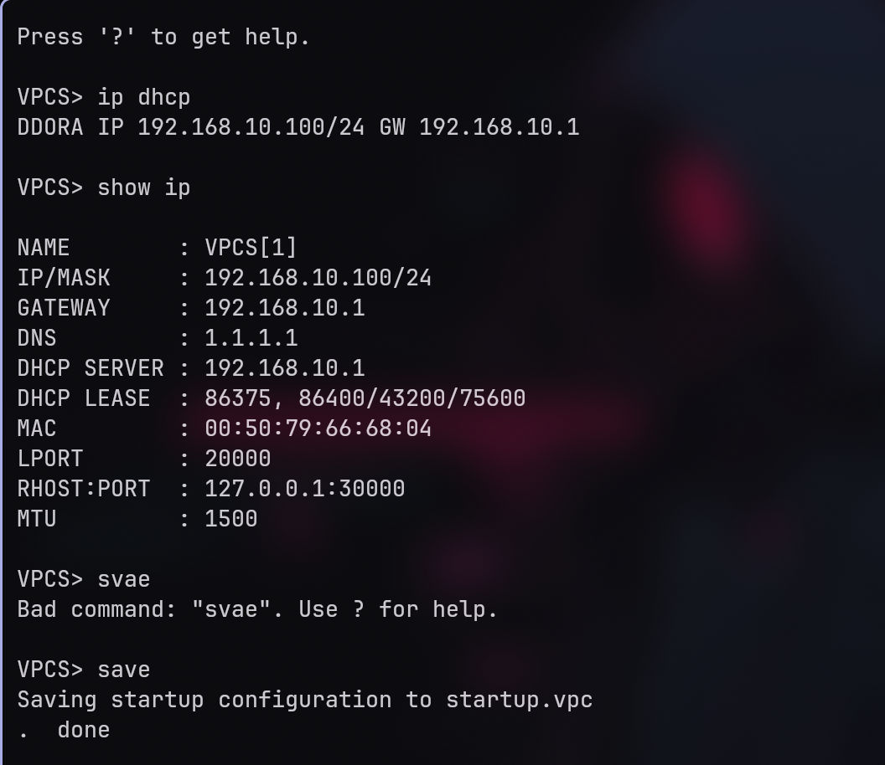
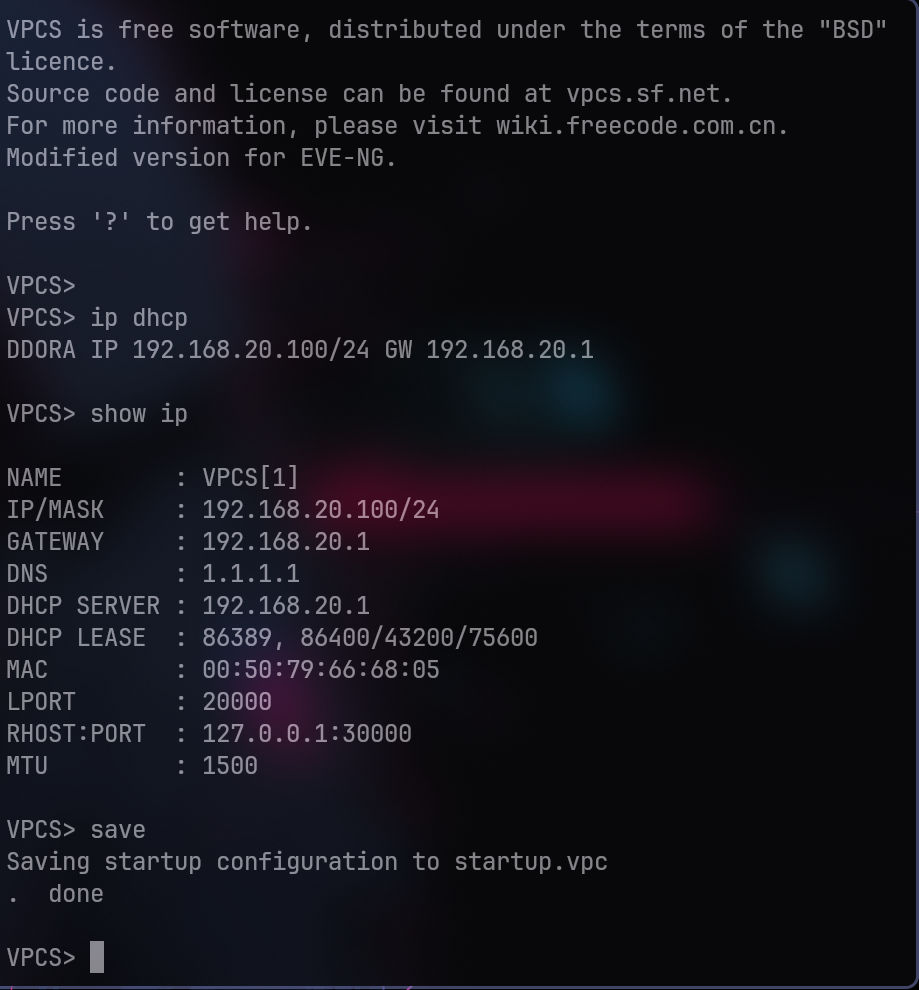

# Project 01: Small Branch Office — VLANs, DHCP & Inter-VLAN Routing

## 1. Overview

This project simulates a small branch office network that separates the Sales and HR departments using VLANs, provides automated IP addressing through DHCP, and enables inter-VLAN communication using Router-on-a-Stick.

**Objectives:**
- Segment departments using VLANs.
- Configure 802.1Q trunking between the switch and router.
- Provide DHCP services for both VLANs.
- Enable inter-VLAN routing.
- Configure baseline device security and SSH management.
- Troubleshoot and resolve a VLAN trunk misconfiguration.

## 2. Topology & IP Addressing

### Devices

- 1 Cisco vIOS router (R1)
- 1 Cisco vIOS-L2 switch (SW1)
- 2 VPCS endpoints (Sales-PC and HR-PC)

### IP Addressing Table

| VLAN | Department | Network | Default Gateway |
|---|---|---|---|
| 10 | Sales | 192.168.10.0/24 | 192.168.10.1 |
| 20 | HR | 192.168.20.0/24 | 192.168.20.1 |

## 3. Baseline Configuration

Baseline security settings were applied before implementing the lab requirements:

- Disabled DNS lookup on supported devices.
- Configured privileged EXEC secrets.
- Created local administrative accounts.
- Configured SSH access and restricted Telnet on VTY lines.
- Added MOTD banners warning against unauthorized access.

Refer to the sanitized device configuration files for the implemented settings.

## 4. Implementation

### Layer 2 — Switching

- Created VLAN 10 (SALES) and VLAN 20 (HR).
- Assigned endpoint-facing switchports to their respective access VLANs.
- Configured an 802.1Q trunk between SW1 and R1.
- Restricted the trunk's allowed VLAN list to the VLANs required by the design.

### Layer 3 — Inter-VLAN Routing

- Configured router subinterfaces on R1.
- Associated each subinterface with the appropriate VLAN using 802.1Q encapsulation.
- Configured the default gateway for each department.

### DHCP Services

- Configured DHCP pools on R1 for both VLANs.
- Verified the IP addressing assigned to the Sales and HR endpoints.

## 5. Verification & Results

### VLAN and Trunk Status

### Router Interfaces

### DHCP Address Assignment

### Connectivity Tests

The recorded lab evidence documents DHCP address assignment and inter-VLAN connectivity testing. See the screenshots above for the actual command output and results.

## 6. Troubleshooting

A deliberate trunk misconfiguration was introduced to simulate a real-world Layer 2 connectivity incident. VLAN 20 was removed from the trunk's allowed VLAN list.

The investigation focused on identifying the affected VLAN, checking trunk status, and restoring the required VLAN to the trunk.

**Incident report:** [VLAN 20 Trunk Misconfiguration](troubleshooting/trunk-vlan-20-issue.md)

### Incident Evidence

**Symptoms**

**Investigation**

**Fix and Verification**

## 7. Lessons Learned

- Verify trunk operational status and allowed VLANs when investigating connectivity issues.
- Confirm DHCP address assignment and default gateway configuration on endpoints.
- Understand how 802.1Q tagging carries traffic for multiple VLANs over a trunk.
- Validate connectivity after corrective changes instead of assuming the issue is resolved.
- Distinguish VLAN segmentation from access control: inter-VLAN communication must be restricted explicitly when required by the security policy.

## 8. Device Configurations

- [R1 Configuration](configs/R1.md)
- [SW1 Configuration](configs/SW1.md)

The configuration files are sanitized documentation copies. They are intended for review and may require adaptation to the target IOS image and lab environment.
