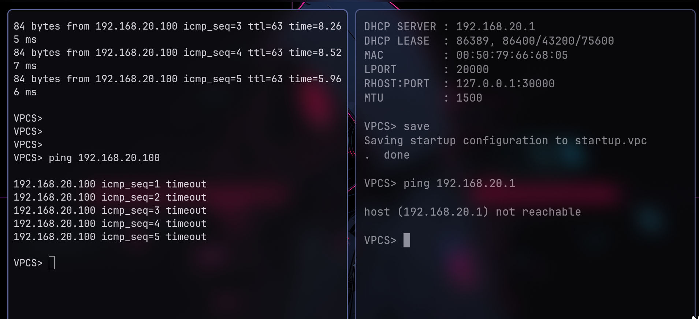
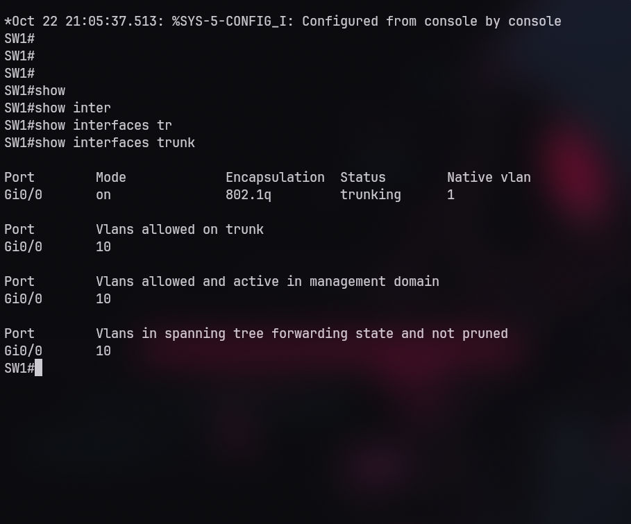
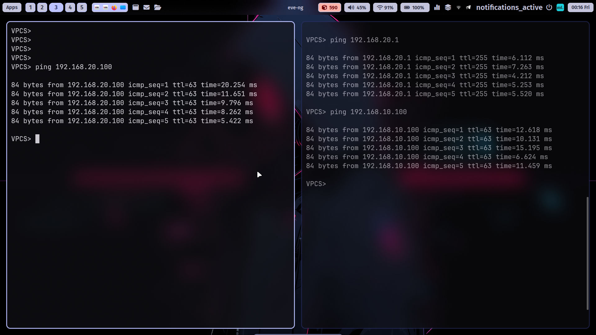

# Incident Report: Simulated VLAN 20 Connectivity Loss

## 1. The Incident (Symptom)

During the verification phase, a deliberate trunk misconfiguration was introduced to simulate a real-world network connectivity incident.

**Observed symptoms:**
- PC-SALES (VLAN 10) could not reach PC-HR (VLAN 20); ping requests timed out.
- PC-HR could not reach its default gateway (`192.168.20.1`).

**Initial impact:** VLAN 20 connectivity was disrupted, affecting communication with the router and between the two departments.

### Evidence — Symptoms



## 2. Investigation

Connectivity tests were performed from the endpoints to identify the scope of the failure.

The following command was executed on SW1:

```cisco
show interfaces trunk
```

The output showed that the trunk's allowed VLAN list contained VLAN 10 but did not include VLAN 20.

This finding identified the trunk configuration as the primary area requiring investigation.

### Evidence — Investigation



## 3. Root Cause

The trunk interface on SW1 was manually configured to allow only VLAN 10. VLAN 20 was omitted from the allowed VLAN list.

As a result, VLAN 20 traffic could not traverse the SW1–R1 trunk. This prevented PC-HR from reaching its default gateway through R1 and disrupted inter-VLAN communication between PC-SALES and PC-HR.

## 4. The Fix & Verification

### Corrective Action

The trunk interface on SW1 was reconfigured to allow both VLANs:

```cisco
configure terminal
interface GigabitEthernet0/0
 switchport trunk allowed vlan 10,20
end
```

### Verification

After applying the correction, the following checks were performed:

1. Executed `show interfaces trunk` on SW1 and confirmed that VLANs 10 and 20 were in the allowed VLAN list.
2. Retested connectivity from PC-SALES to PC-HR; the ping succeeded, with 5 out of 5 packets received.
3. Retested connectivity from PC-HR to its default gateway; the ping succeeded.

**Result:** The trunk configuration was corrected, and the reported connectivity tests passed.

### Evidence — Fix and Verification



## Lessons Learned

- Check the trunk's allowed VLAN list when diagnosing connectivity issues affecting a specific VLAN.
- Test both endpoint-to-gateway and end-to-end connectivity to narrow down the failure.
- Confirm the correction with command output and connectivity tests rather than assuming the issue is resolved.
- VLANs provide network segmentation, but additional access-control policies are required when communication between VLANs must be restricted.
