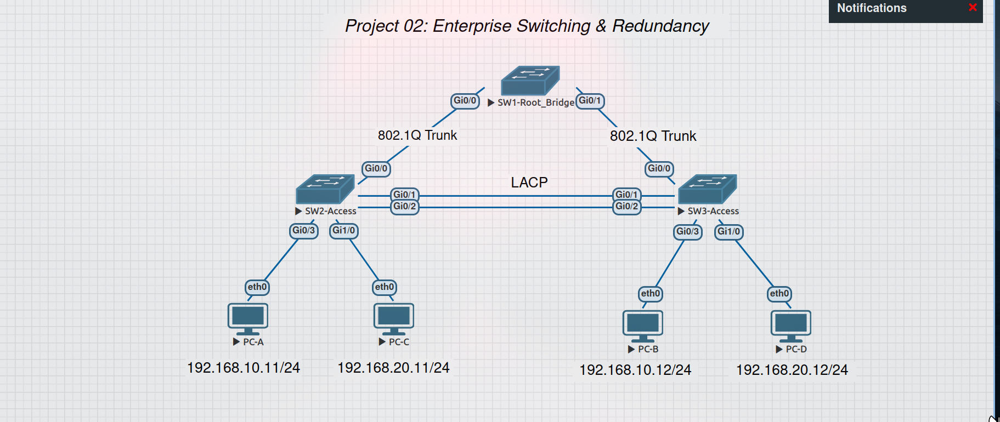
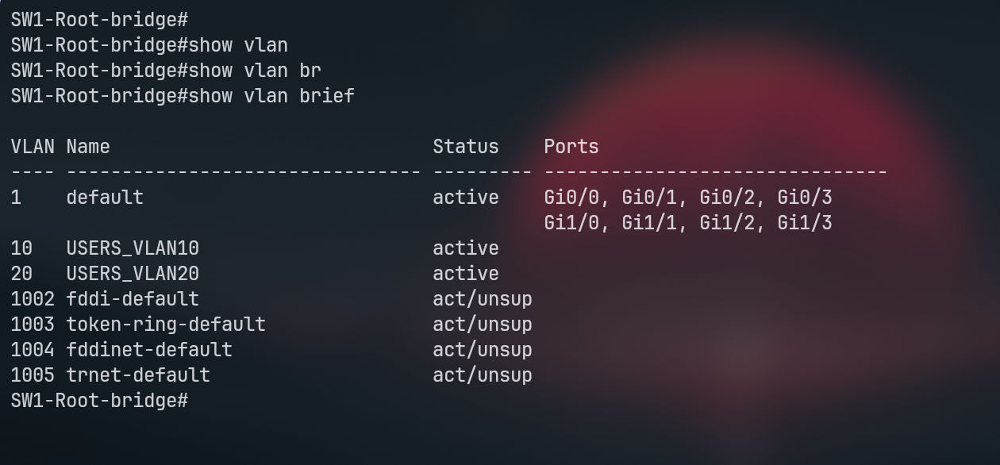
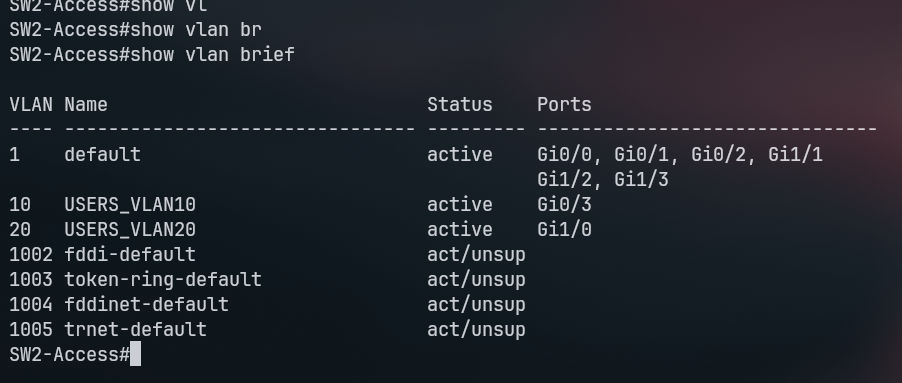
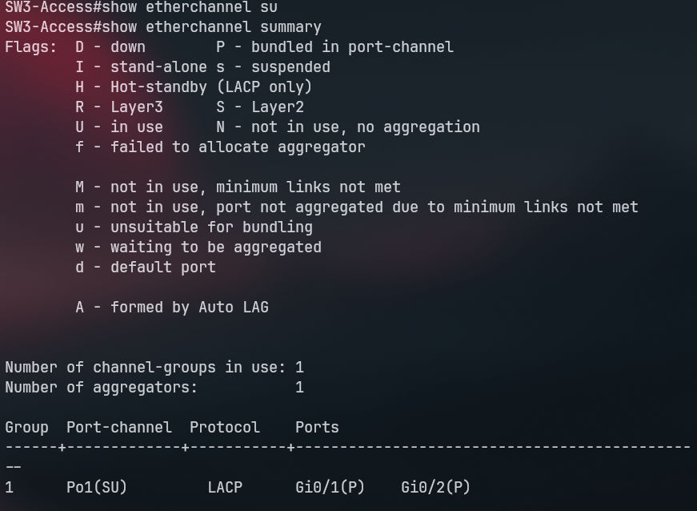
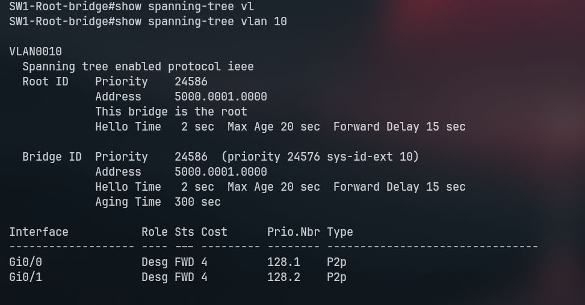
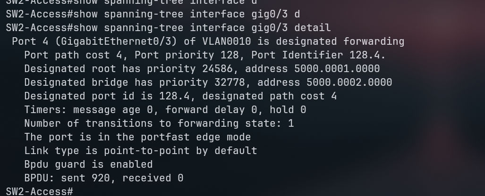
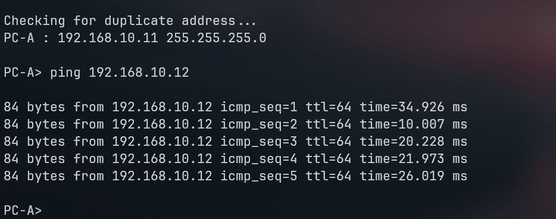

# 🏢 Project 02: Enterprise Switching & Redundancy

## 📌 Overview
A highly available Layer 2 enterprise network built with a triangle topology (SW1, SW2, SW3). The project demonstrates how to combine VLANs, 802.1Q Trunking, LACP EtherChannel for bandwidth aggregation, Spanning Tree Protocol (STP) for loop prevention, and STP Security to protect access ports.

## 🏗️ Topology & IP Plan

- **Devices:** 3x Cisco vIOS-L2 Switches, 4x VPCS.
- **VLAN 10 (USERS_VLAN10):** 192.168.10.0/24 (PC-A: .11, PC-B: .12).
- **VLAN 20 (USERS_VLAN20):** 192.168.20.0/24 (PC-C: .11, PC-D: .12).
- **Switch Roles:** SW1 (Root Bridge), SW2 (Access), SW3 (Access).

## ⚙️ Implementation
- **VLANs & Trunks:** Configured VLANs 10 & 20 and allowed them over 802.1Q Trunks between switches.
- **EtherChannel (LACP):** Bundled Gi0/1 and Gi0/2 between SW2 and SW3 into Port-Channel 1 using LACP.
- **Spanning Tree (STP):** Configured SW1 as the Primary Root Bridge.
- **STP Security:** Enabled PortFast and BPDU Guard on all end-device access ports.

## 🧪 Verification & Results

### 1. VLAN & Trunking
Access ports correctly assigned to their respective VLANs.

### 2. EtherChannel (LACP)
Port-Channel 1 successfully bundled using LACP.

### 3. Spanning Tree (STP) & Security
- SW1 is confirmed as the Root Bridge.

- PortFast and BPDU Guard are active on access ports to prevent loops.

### 4. Connectivity Tests
Successful intra-VLAN ping between PC-A and PC-B.

## 💡 Lessons Learned
- STP is critical in redundant topologies to prevent Layer 2 loops.
- LACP EtherChannel provides increased bandwidth without causing STP loops.
- BPDU Guard protects the network from rogue switches connected to access ports.
- Switches alone cannot route traffic between different VLANs (Inter-VLAN requires a Layer 3 device).

## 📂 Device Configurations
- [SW1 Configuration](configs/SW1.txt)
- [SW2 Configuration](configs/SW2.txt)
- [SW3 Configuration](configs/SW3.txt)
