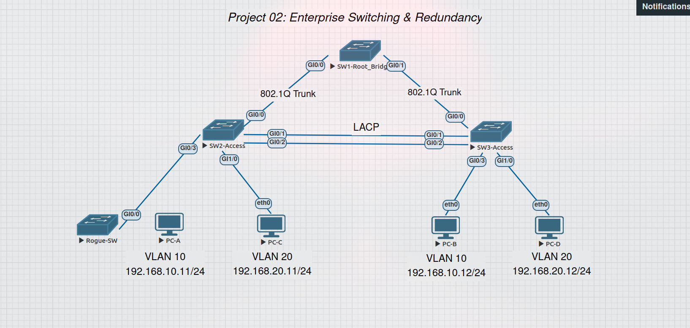
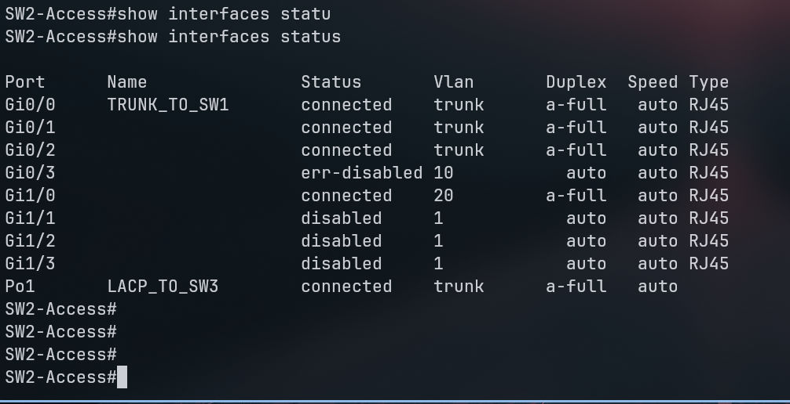
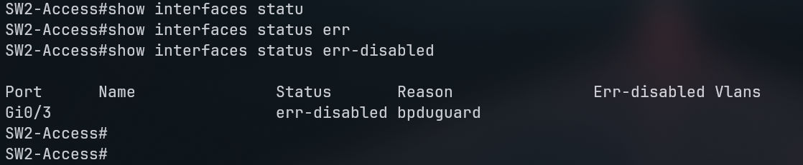
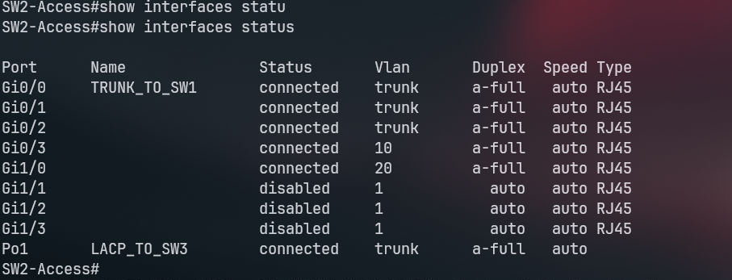
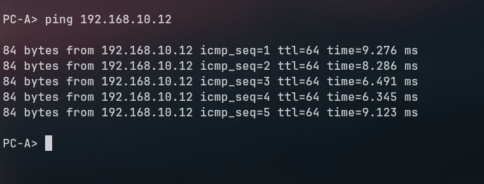

# 🚨 Incident Report: BPDU Guard Triggered on Access Port

## 1. The Incident (Symptom)
During a security audit test, a rogue switch was deliberately connected to an access port (Gi0/3) on SW2. The BPDU Guard feature immediately shut down the port to prevent a Layer 2 loop. PC-A lost connectivity.





## 2. Investigation
- Checked the interface status on SW2: `show interfaces status` revealed Gi0/3 is in `err-disabled` state.
- Checked the exact reason using `show interfaces status err-disabled`, which confirmed the reason is `bpduguard`.



## 3. Root Cause
An unauthorized switch sending BPDUs was connected to a user-facing access port. BPDU Guard worked exactly as designed to prevent a network loop and protect the Layer 2 topology.

## 4. The Fix & Verification
- Removed the rogue switch and reconnected PC-A.
- Re-enabled the port manually:
```cisco
interface gi0/3
 shutdown
 no shutdown
```
- Verified that the port returned to `connected` state and PC-A regained connectivity.



```
